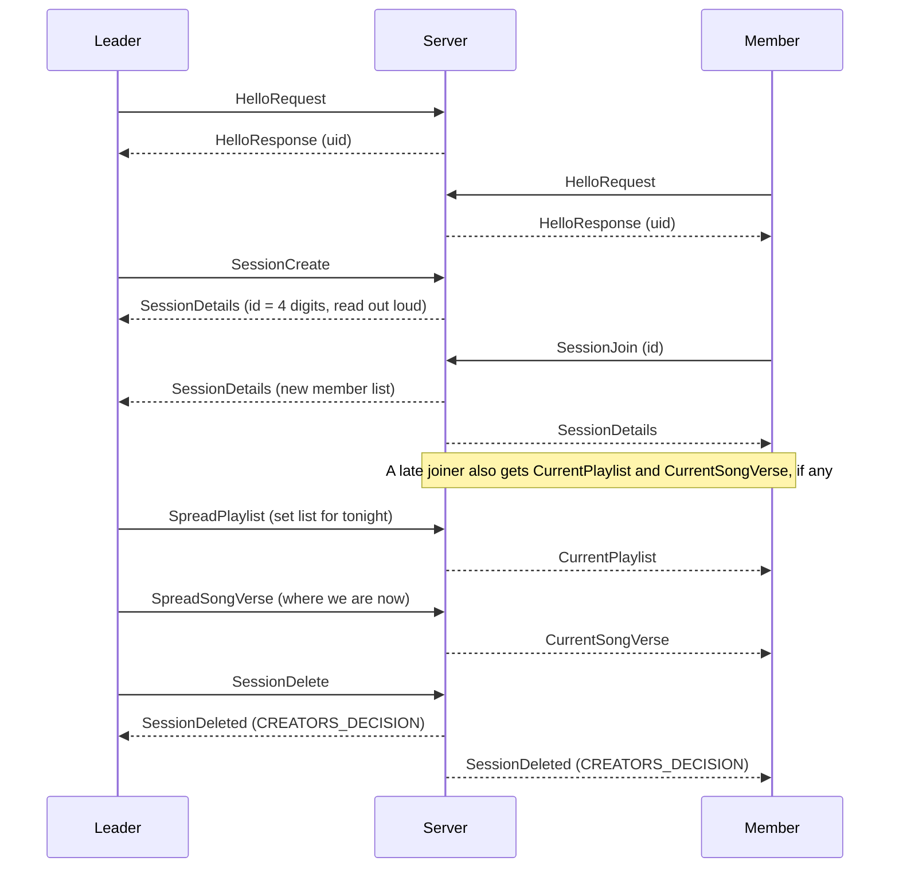
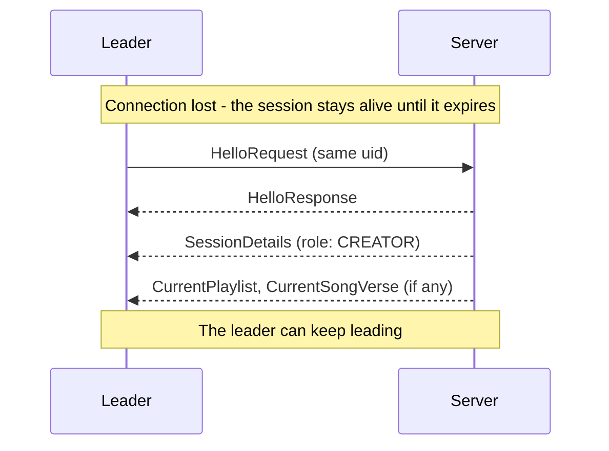

# songbook-protocol

Binary protocol ([Bebop](https://github.com/betwixt-labs/bebop)) spoken over WebSocket between the Songbook PWA and the session server. The source of truth is [`schema.bop`](schema.bop). `schema.ts`/`schema.js` are generated (`npm run build`) and published by CI to the major-version branches (`v3`, ...) and tags (`v3.0.0`, ...).

All frames are **binary**. Client sends a `Command`, server sends a `Message`.

## Identity

The first command must be `HelloRequest { name, uid? }`; everything else before it is refused with `INVALID_COMMAND`.

- No `uid` → the server generates one and returns it in `HelloResponse`. The client stores it (cookie).
- Known `uid` → the server keeps it. **The UID is the only proof of identity**, so it is never sent to other people (members only see names).

## Typical flow

Reconnecting after a dropped connection (e.g. the leader's phone froze):

## Commands (client → server)

| Command | Who | Notes |
|---|---|---|
| `HelloRequest` | anyone | handshake, required first |
| `SessionCreate` / `SessionDelete` | leader | one session per user |
| `SessionJoin { id }` / `SessionLeave` | member | the leader cannot leave, only delete |
| `SessionGet` | member | re-request `SessionDetails` |
| `SpreadSongVerse { songSlug, verseIdx }` | leader | |
| `SpreadPlaylist { name, songSlugs[] }` | leader | 1–200 songs. Playlists are local to every device, so the **content** is sent, not an id |

## Messages (server → client)

| Message | Notes |
|---|---|
| `HelloResponse { uid }` | |
| `SessionDetails { id, expires, members[] }` | |
| `SessionDeleted { reason }` | `EXPIRED`, `CREATORS_DECISION`, `USER_LEFT` |
| `CurrentSongVerse` | not echoed to the leader |
| `CurrentPlaylist` | not echoed to the leader |
| `ErrorMessage { code }` | see `ErrorCode` |

A user who joins or reconnects gets `SessionDetails`, then `CurrentPlaylist` (if any), then `CurrentSongVerse` (if any).

## Session lifetime

A session lives 2 hours (about one prayer session), refreshed while the leader's connection answers heartbeats. A dropped connection does **not** end the session: the leader can reconnect with the same UID and gets the session and the creator role back.

## Changing the schema

Keep it backward compatible where you can: only **append** new union indexes and enum values, never renumber. Renaming or removing a field is a breaking change (`feat!:` commit → new major version).
